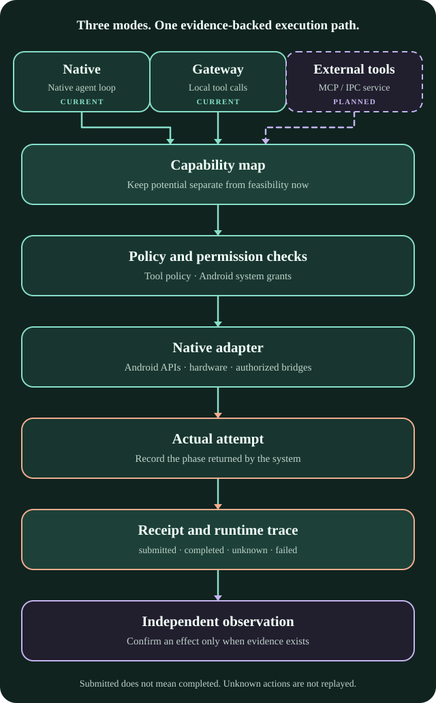

# AndroBody

<strong>Give agents native Android capabilities, with receipts that show what actually happened.</strong>

<a href="README.md">简体中文</a> · <a href="README.en.md">English</a>

<a href="https://arcj137442.github.io/AndroBody/">Product site</a> · <a href="docs/ROADMAP.en.md">Roadmap</a> · <a href="docs/ARCHITECTURE.en.md">Architecture</a> · <a href="docs/README.en.md">Documentation</a>

Architecture schematic, not a screenshot of the current APK or device-acceptance evidence.

AndroBody is a native Android agent and capability layer. It lets an agent call device and system functions within user-granted scope, while keeping theoretical potential, current feasibility, actual attempts, and verifiable results distinct.

## Three integration modes

| Mode | Owner of the model loop | Status |
|---|---|---|
| **Native** | AndroBody | Implemented: local conversations, model requests, and Android tool calls |
| **Gateway** | AndroBody | Implemented: compatible clients send requests; the local app routes to its model and runs enabled tools |
| **External Tool Service** | External Harness | Planned: direct MCP/IPC tool serving is not implemented |

## Current capabilities

- Read device, battery, network, and bounded sensor state.
- Read notifications with Android Notification Access and publish AndroBody notifications.
- Record bounded local audio and use text-to-speech; recordings stay in app-private storage by default.
- Create, read, edit, and delete workspace text files.
- Encrypted sessions, tool receipts, runtime traces, and an exportable app-level runtime console.
- Discover and configure Anthropic Messages and OpenAI Chat Completions compatible routes.

A permission switch only indicates that Android allows a class of access. It does not prove that a tool ran or that a target effect occurred. Results show the actual stage; without independent evidence, the outcome remains unknown.

## Planned or not fully verified

Generic Intent, system speech recognition, Shell/PTY, Shizuku/Root adapters, automatic context compaction and long-term memory, general event triggers, and direct MCP/IPC tool serving remain on the roadmap. Planned capabilities are not presented as available actions.

## Verification boundary

The current source corresponds to the `0.6.9` internal verification candidate. Its APK uses an Android debug certificate; it is not a stable release and is not published in this repository. Existing build records show 92 JVM tests per identity variant, lint, and APK assembly; Android instrumentation was not run. These are prior internal build records and were not rerun for this documentation update; raw device logs are not included in the public repository. Real-model billing, ARM64 runtime, notification reading, and human visual/audio acceptance require separate checks for each device and configuration.

## Build

On Windows PowerShell, use the checked-in Gradle wrapper:

~~~powershell
android\gradlew.bat -p android -PtestBuildType=verification :app:assembleAndrobodyVerification
android\gradlew.bat -p android -PtestBuildType=verification :app:assembleLegacyMigrationVerification
~~~

Verification variants use separate application IDs and debug signing. They are not production releases.

## Documentation

- [Capability roadmap](docs/ROADMAP.en.md) · [简体中文](docs/ROADMAP.md)
- [Architecture and evidence flow](docs/ARCHITECTURE.en.md) · [简体中文](docs/ARCHITECTURE.md)
- [Inspectable delegation contract](docs/architecture/INSPECTABLE_DELEGATION.en.md) · [简体中文](docs/architecture/INSPECTABLE_DELEGATION.md)
- [Third-party dependency licenses](docs/licenses/README.en.md) · [简体中文](docs/licenses/README.md)

AndroBody has not declared a project-wide software license. Public visibility does not grant rights to copy, modify, or redistribute the project; each dependency remains under its own license.
