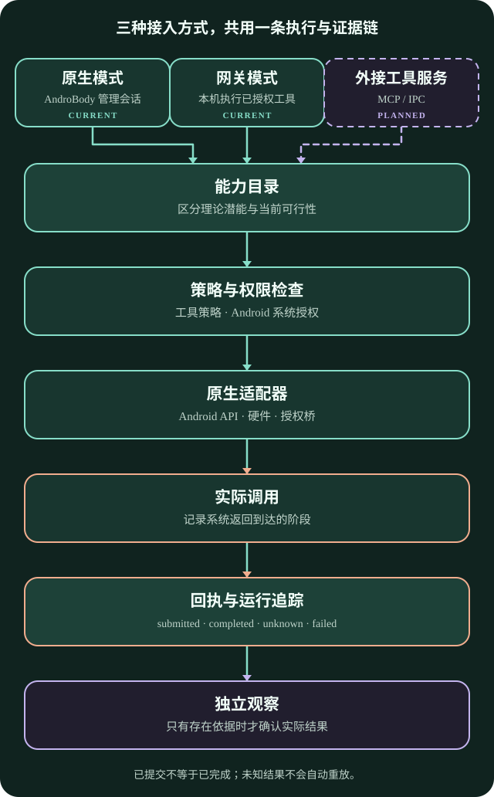

# 架构与证据流

**语言** · [简体中文](ARCHITECTURE.md) · [English](ARCHITECTURE.en.md)

实线表示当前实现路径；虚线表示规划中的外接工具服务。图示不代表设备验收结果。

## 产品模式

- **Native**：AndroBody 管理对话、模型请求与 Android 工具循环。
- **Gateway**：兼容客户端连接本机网关；模型配置、工具策略和本机执行仍由 AndroBody 管理。
- **External Tool Service**：规划中。外部 Harness 可调用明确开放的 AndroBody 工具，但不会因此获得应用 UID、Android 权限、模型凭据或其他应用私有数据。

## 工具执行与证据

工具请求经过能力策略、Android 权限与运行条件检查、适配器调用，并返回结构化回执。回执区分已请求、等待审批、已提交、已完成、未知和失败等阶段。系统接受派发不等于目标应用完成任务。结果未知时应保留核对入口，不自动重放。

能力目录保持开放。每项能力分别记录理论潜能、当前可行性、真实尝试与观察结果。Android 版本、应用身份、硬件、组件导出规则、用户授权和合法桥接都会影响可行性。静态分析可以提出候选路径；只有实际尝试才能确立实测阻碍。

## 持久化与诊断

本机对话与回执保存在应用保护存储中。应用级运行控制台记录可把请求、会话、工具调用和结果关联起来的运行元数据。它不读取整个 Android 系统日志或其他应用的日志。

普通诊断默认排除凭据、提示词、通知正文、音频和文件内容。向模型发送内容、读取本地文件或导出敏感数据时，分别走明确的范围与同意路径。

## 当前实现边界

原生应用包含设备/网络/电量读取、有限传感器采样、通知读取与发布、TTS、本机限时录音、工作区文本文件增删改查、加密会话、应用级运行台和兼容模型网关。每项能力仍受系统权限、设备条件与当前验证证据约束。

通用 Intent、系统语音识别、Shell/PTY、Shizuku/Root 适配、自动上下文压缩与长期记忆、通用事件触发器、直接 MCP/IPC 工具服务仍在规划或尚未完整实现。具体次序见[路线图](ROADMAP.md)。
